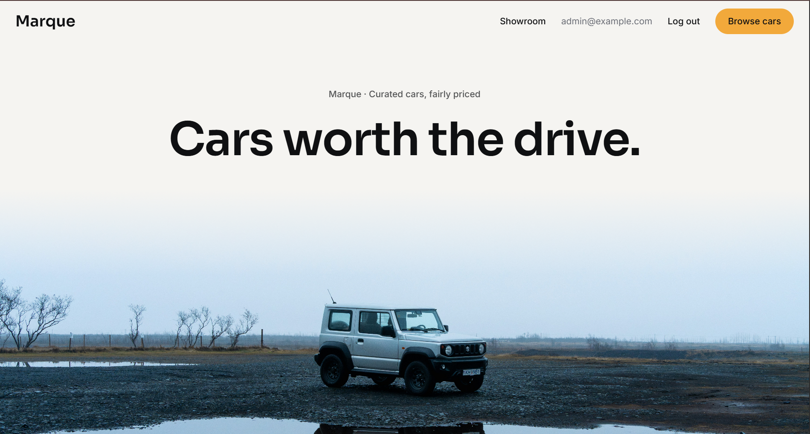
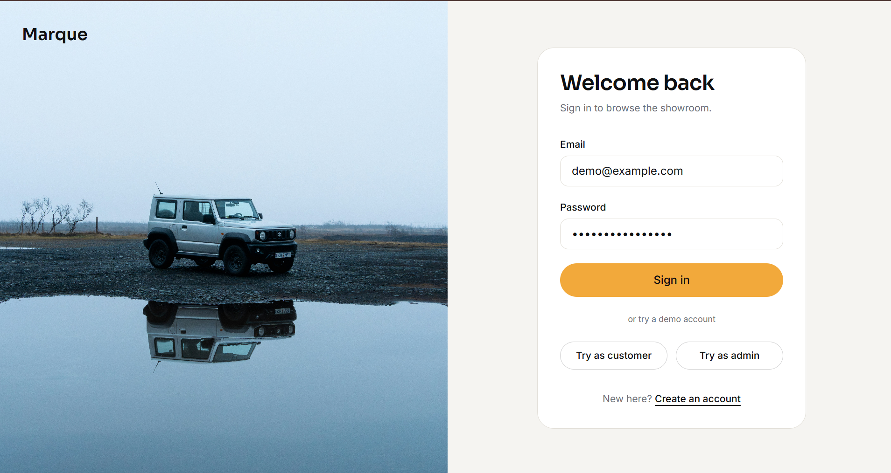
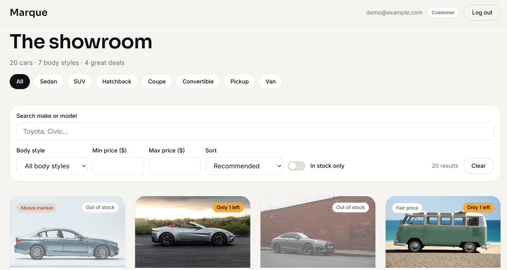
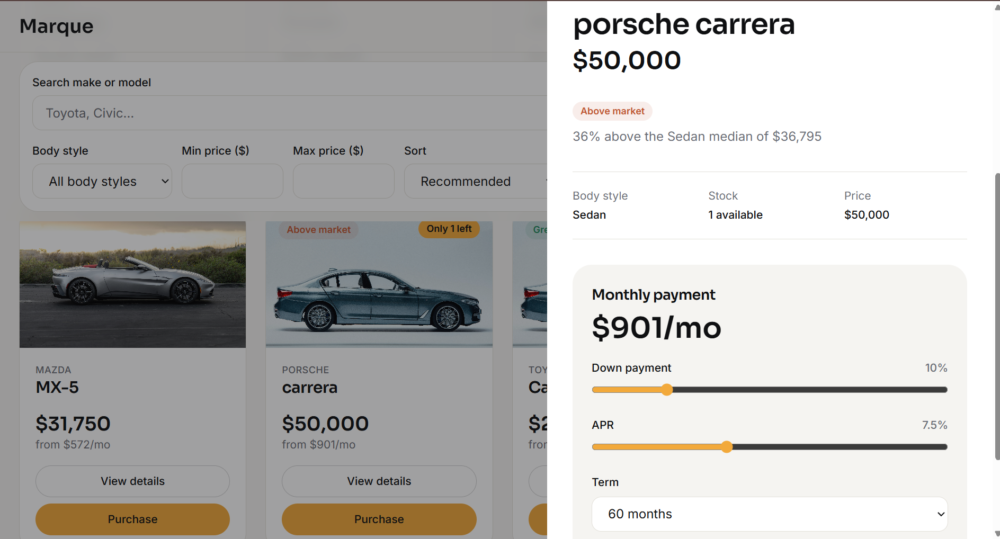
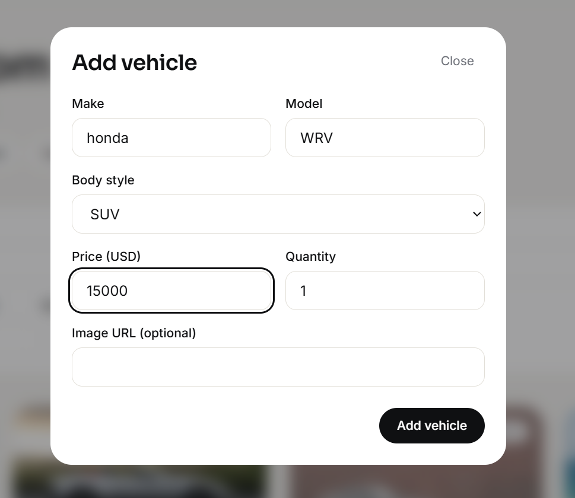

# Car Dealership Inventory System

Marque is a full-stack car dealership inventory app, built test-first. Customers register, browse a showroom of every vehicle, search and filter it, and purchase cars, with a Purchase button that is disabled when a car is out of stock. Admins add, edit, restock and delete vehicles from the same showroom. The backend is an Express 5 and TypeScript API over PostgreSQL, secured with JWTs. The frontend is a React single-page app styled with Tailwind CSS.

**Live demo**: [https://car-dealership-inventory-beige.vercel.app](https://car-dealership-inventory-beige.vercel.app)

- Demo accounts: the customer `demo@example.com` and the admin `admin@example.com`. The **Try as customer** and **Try as admin** buttons on the login page fill in their credentials.
- The API runs on Render's free tier, which sleeps when idle. The first request after that can take up to a minute; the app shows a banner while the server wakes.
- The demo data is sample data and may be reset.

## Screenshots

| | |
| --- | --- |
|  |  |
|  |  |
|  |  |

## Features

From the brief:

- Registration and login, with JWT-secured endpoints.
- A showroom listing every vehicle, including those out of stock.
- Search by make or model, and filters for body style and price range.
- A Purchase button on each vehicle, disabled when its quantity is zero.
- Admin controls to add, edit and delete vehicles, and to restock them.

Extras:

- **Deal rating**: a badge comparing each car's price with the median of its body style (`GET /api/deal-ratings`).
- **EMI calculator**: a "from $X/mo" estimate on each card, and a calculator in the details panel where the down payment, rate and term can be changed.
- **Filters in the URL**: search, body style, price, in-stock only, sort and the open car live in the query string, so a view can be shared and Back and Forward step through it.
- **Two-click purchase**: the first click asks for confirmation with the price; the second buys.
- **Admin dialogs**: add, edit, restock and delete open in dialogs with inline validation, and the showroom updates without a reload.

## Tech stack

| Layer | Stack |
| --- | --- |
| Backend | Node.js, TypeScript, Express 5, Prisma 6, PostgreSQL (Supabase), Zod, JWT, bcrypt |
| Frontend | React, TypeScript, Vite, Tailwind CSS v4, React Router, TanStack Query |
| Tests | Vitest, Supertest, React Testing Library, MSW, `@vitest/coverage-v8` |
| Hosting | Render (API), Vercel (frontend) |

## Architecture

Both sides are split into feature modules. On the backend, each module has its own routes, controller, service and repository, wired together in one place (`app.ts`). On the frontend, each feature has its own folder and is imported only through its `index.ts`. The admin controls are plugged into the showroom through props in `app/ShowroomRoute.tsx`, so the vehicles feature never depends on admin. See [architecture.md](architecture.md).

## API

All `/api/vehicles` routes require `Authorization: Bearer <token>`.

| Method and path | Access | Purpose |
| --- | --- | --- |
| `POST /api/auth/register` | Public | Create an account |
| `POST /api/auth/login` | Public | Get a token |
| `GET /api/vehicles` | User | List all vehicles, including out of stock |
| `GET /api/vehicles/search` | User | Filter by `make`, `model`, `category`, `minPrice`, `maxPrice` |
| `POST /api/vehicles` | Admin | Add a vehicle |
| `PUT /api/vehicles/:id` | Admin | Update a vehicle's details |
| `DELETE /api/vehicles/:id` | Admin | Delete a vehicle |
| `POST /api/vehicles/:id/purchase` | User | Buy (default 1, or `quantity`) |
| `POST /api/vehicles/:id/restock` | Admin | Add `quantity` (1 to 10000) to stock |
| `GET /api/deal-ratings` | User | Deal rating per vehicle (extra) |

Errors always return `{ "error": { "code": "...", "message": "..." } }`.

## Design decisions

- **`POST` and `PUT /api/vehicles` are admin-only.** The brief marks only delete and restock as admin-only, but gives the add and edit forms to admins; an open API would let any customer change prices.
- **The vehicle list includes out-of-stock cars**, so the disabled Purchase button can appear.
- **Stock changes only through purchase and restock**, and the decrement is atomic, so stock never goes below zero.
- **Admin accounts come from the seed script**; register always creates a normal user.
- **Admin controls live inside the showroom**, not on a separate admin site. The server enforces every admin rule regardless of what the UI shows.
- **Client-side validation mirrors the server's**, for faster feedback; the server stays the authority.

The full reasoning, with the cost of each choice, is in [tradeoffs.md](tradeoffs.md).

## Running locally

### Prerequisites

- Node.js 22.
- A PostgreSQL database. Any Postgres works, for example a free Supabase project or a local install.

The backend uses two schemas in that database, chosen by the query string on `DATABASE_URL`: `?schema=dev` for development and `?schema=test` for the test suite. The tests refuse to run against any other schema, because they empty the database between cases.

### Backend

From `backend/`:

1. `npm install`
2. Copy `.env.example` to `.env` (the `dev` schema) and `.env.test.example` to `.env.test` (the `test` schema). Set `DATABASE_URL`, `JWT_SECRET` and the seed accounts in both.
3. `npm run db:migrate` to apply the migrations to the dev schema.
4. `npm run db:test:migrate` to apply them to the test schema.
5. `npm run db:seed` to create the admin and demo accounts and the sample vehicles.
6. `npm run dev` to start the API on `http://localhost:4000`.

### Frontend

From `frontend/`:

1. `npm install`
2. Copy `.env.example` to `.env`. `VITE_API_URL` points at the local API, and the `VITE_DEMO_*` values should match the seed accounts in `backend/.env`.
3. `npm run dev` to start the app on `http://localhost:5173`.

## Running tests

| | Tests | Coverage |
| --- | --- | --- |
| Backend (from `backend/`) | `npm test` | `npm run test:coverage` |
| Frontend (from `frontend/`) | `npm test` | `npm run test:coverage` |

The frontend also has `npm run typecheck` (app, config and tests) and `npm run lint`.

The latest results are in [docs/test-report.md](docs/test-report.md):

- Backend: 20 test files, 140 tests passed. The integration tests run against a real PostgreSQL test schema.
- Frontend: 17 test files, 110 tests passed.

## Deployment

The API is a Node web service on Render, and the frontend is a Vite app on Vercel, with production data in a separate `prod` schema. The steps are in [docs/deployment.md](docs/deployment.md).

## Commit history

Each block of work follows Red then Green. A `test:` commit adds failing tests for the next slice, and the `feat:` commit after it adds the code that makes them pass. `refactor:`, `build:` and `style:` commits sit between these pairs, for setup, configuration and visual changes that add no behaviour.

## My AI Usage

### Tools

- **Cursor**, in agent mode, which builds the code. Some chats ran on different underlying models, including Grok.
- **Claude**, for planning, architecture, writing the block-by-block Cursor prompts, and reviewing each step's output.

### How I used them

For each block, Claude wrote a RED prompt and a GREEN prompt. In the RED step, Cursor wrote the failing tests, ran them, and stopped. In the GREEN step, it wrote the code to make them pass and ran the full suite. I reviewed each step, committed it, and made the decisions: the design direction, the scope cuts and the deployment.

Some places where Cursor caught a problem instead of following the prompt literally:

- **Zod 4 `.default` vs `.prefault`**: for the purchase body, the prompt asked for `.default({})`. Cursor pointed out that in Zod 4, `.default({})` returns `{}` without applying the inner `quantity` default. It used `.prefault({})` and left a comment in `inventory.schemas.ts` explaining why.
- **A wrong EMI figure in a prompt**: the RED prompt for the EMI calculator gave an expected monthly payment of 45088 cents. Cursor checked it against the amortization formula, got 45085, wrote the test against the formula, and flagged the difference.
- **The production build excluding tests**: red commits failed to deploy on Vercel because the build type-checked tests that import modules not yet written. Cursor split the TypeScript config so the build checks only app code while `npm run typecheck` still checks the tests, and verified it with a throwaway red test ([tradeoffs.md](tradeoffs.md), entry 46).

**Decisions I made**

- **Architecture goal.** Before any code, I required every feature to be isolated so a change in one couldn't break another. That became the feature-module structure, and the rule that the vehicles feature never imports admin.
- **Process documents.** I set up `context.md` (hard rules from the brief, read by Cursor before every task), `architecture.md` and `tradeoffs.md`, so decisions were written down rather than left inside chats.
- **Database.** With no Docker available, I chose Supabase as the database only, with separate `dev`, `test` and `prod` schemas, and kept auth in our own API as the brief requires.
- **Design direction.** I rejected the first dark "Midnight Motors" direction as too basic, used premium automotive sites as references for a light, photo-led editorial style, and renamed the product Marque.
- **Photography.** I sourced the photos and chose the hero image for how it would sit with the layout; I also set the rule that no text may overlap the car at any screen size.
- **Scope.** I cut orders history, natural-language search and an MCP server to protect the core within one day, but overrode the advice to make deployment optional: it had to ship.
- **Demo access.** I chose real authentication with seeded demo accounts and one-click demo buttons, so reviewers can test both roles.
- **Review and git.** I reviewed every Cursor step before committing, answered its design questions (header placement, test formatting), committed red and green separately, and debugged the deployment and git problems along the way.

**Commit attribution**

Most commits were AI-assisted, as described above. I removed the `Co-authored-by` trailers because the `AI@users.noreply.github.com` address in the brief's format links to an unrelated GitHub user, who was then shown as a contributor to this repository. The full AI involvement is disclosed in this section and in the raw logs in [PROMPTS.md](PROMPTS.md).

### Reflection

The biggest change for me was moving from writing code to directing it. Splitting every block into a RED prompt and a GREEN prompt, and making Cursor stop in between, kept the tests honest; when it did both at once, the red step disappeared. AI was fastest at the parts I'd normally grind through, like test scaffolding, API plumbing and config, and it caught real mistakes, including a wrong EMI figure in one of my own prompts and a Zod 4 default that would have broken purchases with no request body.

It was weakest on judgement. The first design it produced was dark and generic, and I threw it out for a lighter, photo-led direction. Its hero layout ran the headline straight across the car, so I set a rule that no text may overlap the photo at any screen size. I also overruled the suggestion to treat deployment as optional.

Most of my mistakes were process, not code. I ran `git add .` inside `backend/` and committed only half a block without noticing, until the live site showed an old page. Red commits broke the Vercel build until we excluded tests from it. I pasted a database URL into a chat and had to rotate the password. And the noreply address in the co-author format credited a stranger as a contributor.

Next time I'd deploy on day one, commit from the repo root every time, and keep secrets out of every chat from the start.

The raw chat logs are in [PROMPTS.md](PROMPTS.md).

## Credits

- Photos from [Unsplash](https://unsplash.com). Each image is credited in [frontend/public/images/CREDITS.md](frontend/public/images/CREDITS.md).
- Fonts: [Sora](https://fonts.google.com/specimen/Sora) and [Inter](https://fonts.google.com/specimen/Inter), from Google Fonts.
